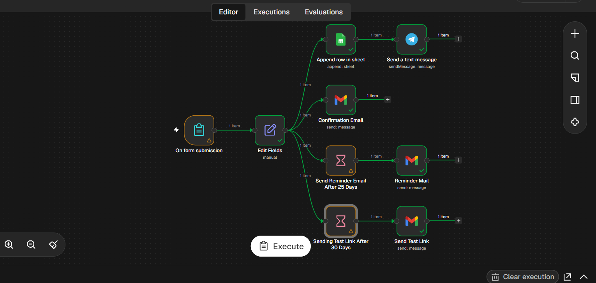
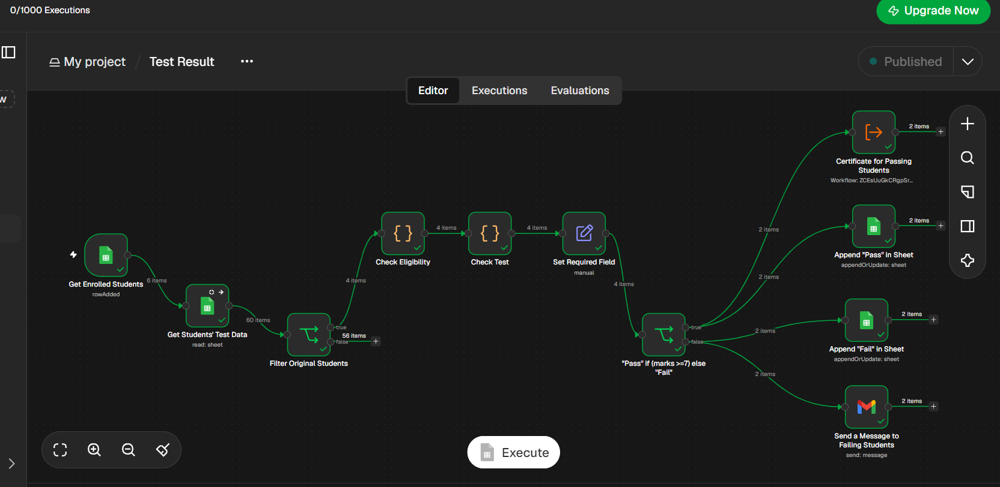
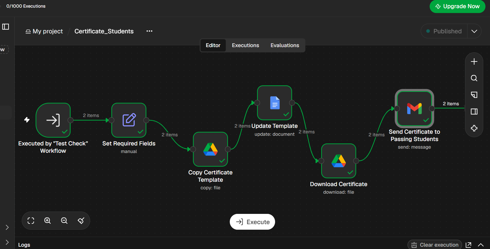
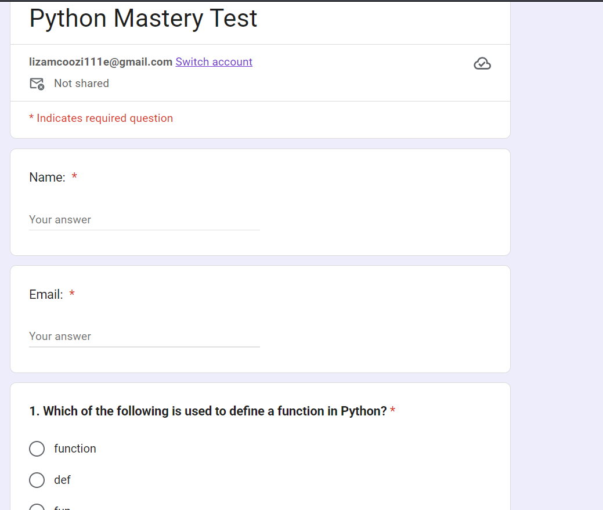
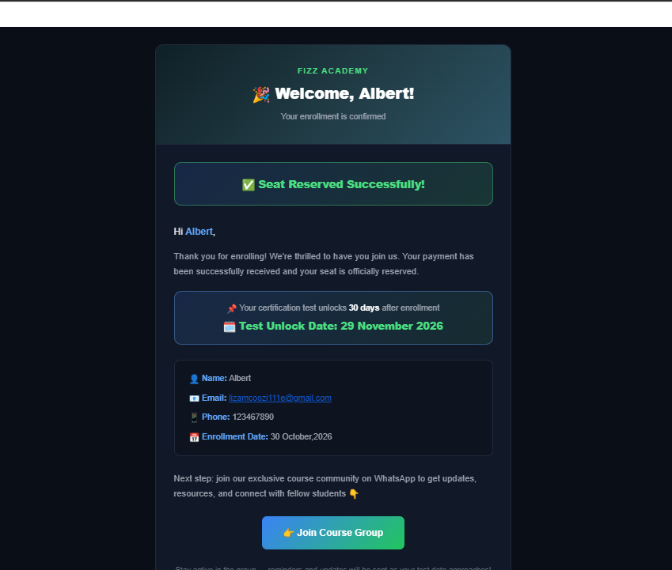
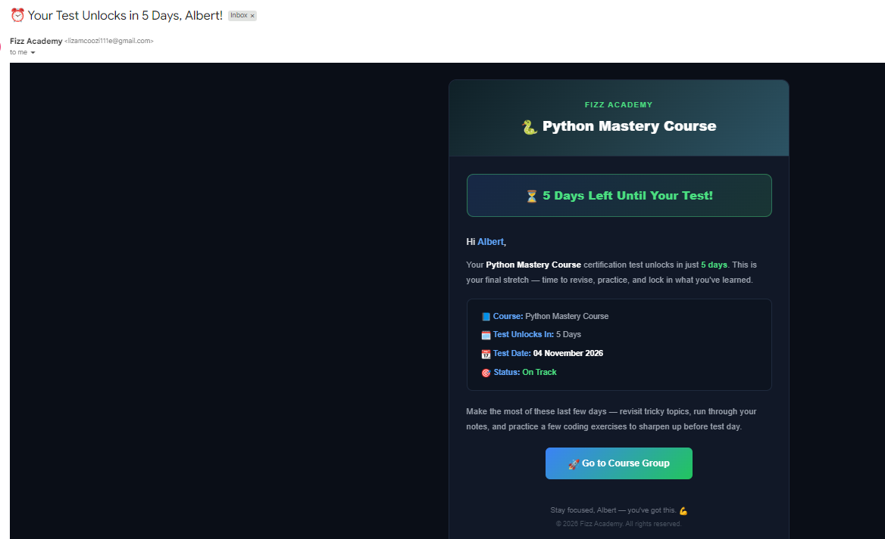
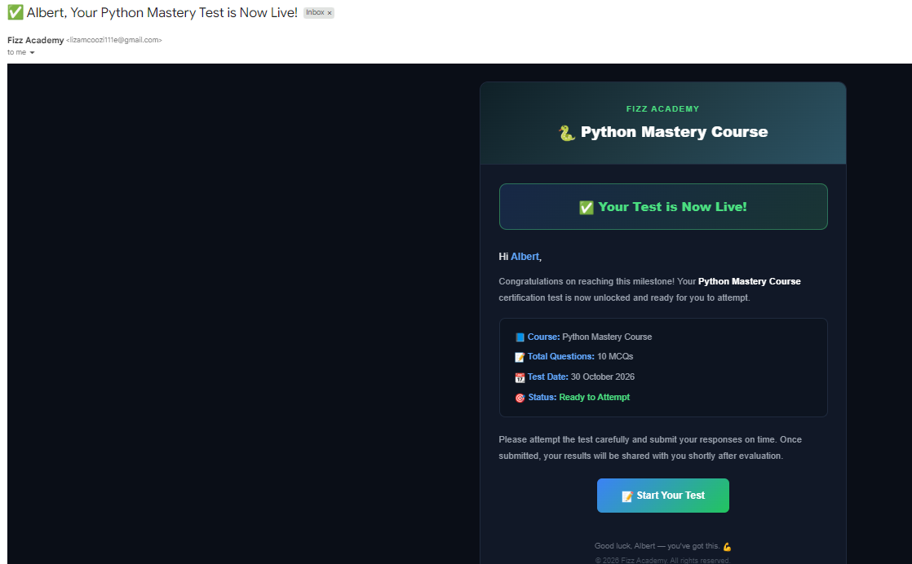
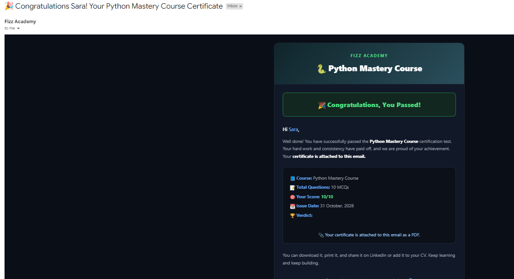
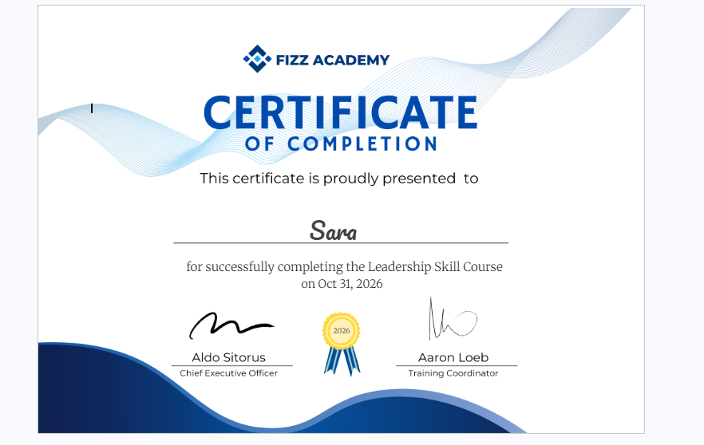

# Student Course Certification — n8n Workflow

A fully automated student lifecycle system built with n8n. Takes a new enrollment from a web form, sends a welcome email, reminds the student before the test, unlocks the test after 30 days, auto-grades the Python MCQ test, and emails either a personalized PDF/Word certificate (Pass) or an encouraging retry message (Fail) — with every result tracked in Google Sheets.

* * *

## What It Does

```
Student fills Enrollment Form
              ↓
   Saved to Google Sheet + Telegram alert to admin
              ↓
   Welcome / Seat-Confirmed email (Test Unlock Date included)
              ↓
   Day 25 → "Test unlocks in 5 days" reminder
   Day 30 → "Your test is live" email with test link
              ↓
   Student submits Python Mastery Test (Google Form)
              ↓
   Hourly trigger picks up the new response
              ↓
   Eligibility check (30+ days since enrollment) → Auto-grade (10 MCQs)
              ↓
     ┌────────┴────────┐
     ↓                  ↓
 Pass (≥ 7/10)      Fail (< 7/10)
     ↓                  ↓
Copy certificate     Result email with
template → fill      tips + retry notice
name/date/year
     ↓                  ↓
Download & email     Mark "Fail" in Sheet
certificate
     ↓
Mark "Pass" in Sheet
```

No manual grading. No manual emailing. No certificate designing. Enroll a student once, and the system handles everything until the certificate lands in their inbox.

* * *

## Features

| Feature                    | Description                                                                                              |
|----------------------------|----------------------------------------------------------------------------------------------------------|
| Enrollment Form            | n8n-hosted form collects Name, Phone No. and Email, then logs the student to Google Sheets               |
| Instant Confirmation       | Branded HTML welcome email with enrollment date and the calculated **Test Unlock Date** (enrollment + 30 days) |
| Admin Telegram Alert       | Every new enrollment is pushed to the admin on Telegram with name, email, phone and date                 |
| Automated Reminders        | Wait nodes send a "5 days left" reminder on day 25 and the test link on day 30                           |
| 30-Day Eligibility Gate    | Only students whose enrollment is 30+ days old are graded — early submissions are ignored                |
| Auto-Grading Engine        | JavaScript node checks all 10 answers against an answer key, with text normalization (case, spaces, smart quotes) |
| Pass / Fail Routing        | Score ≥ 7/10 passes, anything below fails — each path has its own email and Sheet update                 |
| Auto-Generated Certificates| Google Docs template is copied per student, `{name}` `{date}` `{year}` are replaced, then sent as an attachment |
| Result Tracking            | `Result` column in the enrollment sheet is updated to Pass / Fail per student                            |
| Modular Sub-Workflow       | Certificate generation runs as its own callable workflow, reusable from any other flow                   |

* * *

## Workflows

| Workflow                 | Trigger                         | Purpose                                                                  |
|--------------------------|---------------------------------|--------------------------------------------------------------------------|
| `Student_Enrollment`     | n8n Form submission             | Enroll student, notify admin, confirmation email, reminder, test link    |
| `Test_Result`            | Google Sheets (row added, hourly) | Match test to enrollment, check eligibility, grade, route Pass / Fail  |
| `Certificate_Students`   | Executed by `Test_Result`       | Build the personalized certificate and email it to the passing student   |

* * *

## Data Fields

### Enrollment Form

| Field      | Type   | Required |
|------------|--------|----------|
| `Name`     | text   | yes      |
| `Phone No.`| number | yes      |
| `Email`    | email  | yes      |

### Google Sheet — `Student Enrollment` (Sheet1)

| Column          | Filled By                                  |
|-----------------|--------------------------------------------|
| `Student_Name`  | Enrollment workflow                        |
| `Phone`         | Enrollment workflow                        |
| `Student_Email` | Enrollment workflow                        |
| `Date`          | Enrollment workflow (e.g. `30 October,2026`) |
| `Result`        | Test_Result workflow (`Pass` / `Fail`)     |

### Google Sheet — `Test_Result` (Form Responses 1)

| Column            | Description                                   |
|-------------------|-----------------------------------------------|
| `Name: `          | Student name typed in the test form           |
| `Email: `         | Student email typed in the test form          |
| Question 1 – 10   | One column per MCQ (header starts with `1.` … `10.` or `q1` … `q10`) |

> Column headers `Name: ` and `Email: ` contain a **trailing space** (it comes from the Google Form question titles). The workflow expects them exactly as they are.

### Certificate Sub-Workflow Inputs

| Input    | Description                          |
|----------|--------------------------------------|
| `Name:`  | Student name                         |
| `Email:` | Where the certificate is sent        |
| `Score`  | e.g. `10/10`                         |
| `Verdict`| `Pass`                               |

* * *

## Tech Stack

| Tool                    | Purpose                                                         |
|-------------------------|-----------------------------------------------------------------|
| n8n                     | Workflow automation & sub-workflow orchestration                |
| n8n Form Trigger        | Student enrollment form                                         |
| Google Sheets           | Student database, test responses and result tracking            |
| Google Forms            | Python Mastery Test (10 MCQs)                                   |
| Google Docs + Drive     | Certificate template, per-student copy, export to file          |
| Gmail                   | Welcome, reminder, test-live, result and certificate emails     |
| Telegram Bot API        | Admin notification on every new enrollment                      |
| JavaScript (Code node)  | Eligibility check and auto-grading                              |

* * *

## Setup

### 1. Import Workflows

Open n8n → Import from file → import each of the following, **in this order**:

```
Workflows/Certificate_Students.json
Workflows/Test_Result.json
Workflows/Student_Enrollment.json
```

`Certificate_Students` is a sub-workflow called by `Test_Result`, so import it first. After importing, open the `Certificate for Passing Students` node in `Test_Result` and re-select the imported `Certificate_Students` workflow.

### 2. Prepare Google Assets

| Asset                              | What to create                                                                                   |
|------------------------------------|--------------------------------------------------------------------------------------------------|
| Enrollment Sheet                   | Google Sheet with columns `Student_Name`, `Phone`, `Student_Email`, `Date`, `Result`             |
| Python Mastery Test                | Google Form with `Name:`, `Email:` and 10 MCQs, linked to a response Sheet (`Form Responses 1`)  |
| Certificate Template               | Google Doc containing the placeholders `{name}`, `{date}` and `{year}`                            |
| Certificate Storage Folder         | Drive folder where generated certificates are saved                                              |

### 3. Add Credentials

| Credential           | Where to get                                                         |
|----------------------|----------------------------------------------------------------------|
| Google Sheets OAuth2 | [Google Cloud Console](https://console.cloud.google.com/)            |
| Google Drive OAuth2  | [Google Cloud Console](https://console.cloud.google.com/)            |
| Google Docs OAuth2   | [Google Cloud Console](https://console.cloud.google.com/)            |
| Gmail OAuth2         | [Google Cloud Console](https://console.cloud.google.com/)            |
| Telegram Bot API     | [BotFather on Telegram](https://t.me/BotFather)                      |

### 4. Configure Nodes

**`Student_Enrollment`**

- `Append row in sheet` → select your Enrollment Sheet and re-map the columns to your headers
- `Send a text message` → set your own Telegram `chatId`
- `Send Reminder Email After 25 Days` → Wait node, **25 days**
- `Sending Test Link After 30 Days` → Wait node, **30 days** (use a small value like 1 minute while testing)
- Email nodes → update the course group link and the test form link in the HTML buttons

**`Test_Result`**

- `Get Enrolled Students` → point to the Enrollment Sheet (polls every hour for new rows)
- `Get Students' Test Data` → point to the Form Responses sheet
- `Check Test` → edit the `answerKey` array if you change the questions or correct answers
- `Append "Pass" / "Fail" in Sheet` → matches on `Student_Name` and writes the `Result` column
- `Send a Message to Failing Students` → connect Gmail credential

**`Certificate_Students`**

- `Copy Certificate Template` → select your template Doc and destination Drive folder
- `Update Template` → placeholders must match the template exactly: `{name}`, `{date}`, `{year}`
- `Send Certificate to Passing Students` → set sender name and make sure the attachment is mapped to the downloaded binary

### 5. Activate

Toggle **Active** on all three workflows → share the enrollment form URL with students → the rest runs on its own.

* * *

## How It Works

### 1. Enrollment

1. **Form Trigger** collects `Name`, `Phone No.`, `Email`
2. **Edit Fields** normalizes them into `name`, `phone_no`, `email`
3. Four branches then run in parallel:
   - **Append row in sheet** → **Telegram** message to the admin
   - **Confirmation Email** with the Test Unlock Date (`now + 30 days`)
   - **Wait 25 days** → **Reminder Mail** ("Your test unlocks in 5 days")
   - **Wait 30 days** → **Test Link** email ("Your test is now live")

### 2. Test Evaluation

1. **Google Sheets Trigger** fires hourly on every new enrollment row
2. **Get Students' Test Data** reads all test submissions
3. **Filter Original Students** keeps only submissions whose name **and** email match an enrolled student
4. **Check Eligibility** (Code) — passes only students with `days since enrollment ≥ 30`; supports `DD/MM/YYYY` and standard date formats
5. **Check Test** (Code) — compares 10 answers to the answer key after normalizing case, spacing and quotes, then outputs `marks`, `score` (`7/10`) and `Verdict`
6. **Set Required Field** keeps only `Name`, `Email`, `score`, `Verdict`
7. **IF** `Verdict == Pass`
   - **true** → run `Certificate_Students` sub-workflow **and** write `Pass` to the sheet
   - **false** → write `Fail` to the sheet **and** send the retry email

### 3. Certificate Generation

1. **Executed by "Test Check" Workflow** receives `Name`, `Email`, `Score`, `Verdict`
2. **Copy Certificate Template** creates `{Name}_Certificate` in the storage folder
3. **Update Template** replaces `{name}`, `{date}`, `{year}`
4. **Download Certificate** exports the Google Doc as a file
5. **Send Certificate to Passing Students** emails the branded congratulations message with the certificate attached

* * *

## Grading Rules

| Rule                | Value                                   |
|---------------------|-----------------------------------------|
| Total questions     | 10 MCQs                                 |
| Passing score       | 7 / 10                                  |
| Eligibility         | 30 or more days after enrollment        |
| Matching key        | Name **and** Email (case-insensitive)   |
| Answer comparison   | Lower-cased, trimmed, smart quotes normalized |

* * *

## Screenshots

**Student Enrollment Workflow** [](Screenshots/student-enrollment-workflow.png)

**Test Result Workflow** [](Screenshots/test-result-workflow.png)

**Certificate Workflow** [](Screenshots/certificate-workflow.png)

**Python Mastery Test (Google Form)** [](Screenshots/python-test-form.png)

**Welcome / Enrollment Email** [](Screenshots/welcome-email.png)

**5-Day Reminder Email** [](Screenshots/reminder-email.png)

**Test Is Live Email** [](Screenshots/test-live-email.png)

**Fail Result Email** [](Screenshots/fail-email.png)

**Certificate Email (Pass)** [](Screenshots/certificate-email.png)

**Generated Certificate** [](Screenshots/certificate-preview.png)

* * *

## Use Cases

- **Online academies & bootcamps** — automate enrollment, testing and certification for every batch
- **Freelance trainers & coaches** — run a professional course pipeline without an admin team
- **Corporate training teams** — issue verified completion certificates after skill assessments
- **Workshop & webinar organizers** — collect sign-ups and hand out certificates automatically

* * *

## Repository Structure

```
.
├── README.md
├── LICENSE
├── Workflows/
│   ├── Student_Enrollment.json
│   ├── Test_Result.json
│   └── Certificate_Students.json
└── Screenshots/
    └── *.png
```

* * *

## License

MIT — free to use and modify.

* * *

## Author

Built by **Muhammad Farhan** — feel free to connect or contribute!
